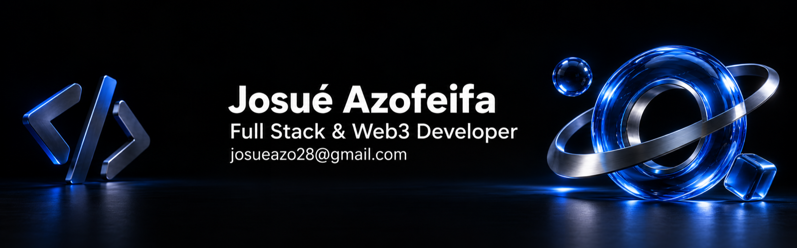

  

 

 

<table border="0" cellspacing="0" cellpadding="0">
<tr>
<td valign="top">

# Hi, I'm Josué 👋

Full Stack Developer from San José, Costa Rica 🇨🇷. I build products end to end — from the API and the database to the last pixel — mostly in the **Stellar** ecosystem.

### About Me

- 💼 Full Stack Developer at **[GrantChain](https://github.com/GrantChain)**, the team behind [GrantFox](https://grantfox.xyz) — open-source funding on Stellar.
- 🎓 Currently building **GrantFox Academy**: courses, server-graded assessments and verifiable badges for people starting in Web3.
- 🗳️ Creator of [VELAR](https://github.com/Velar-Bonds/Velar) — transparent traceability for political bonds on Stellar, built for LATAM.
- 🌍 Active open-source contributor across the Stellar ecosystem: 85+ merged PRs.
- 💬 Ask me about **Next.js**, **NestJS**, **TypeScript**, **Supabase** and **Soroban**.
- ⚡ Fun fact: I love design and building things from scratch.

</td>
<td valign="middle" align="center" width="300">
  
</td>
</tr>
</table>

 

# Tech Stack

## Backend

  
  
  
  
  
  
  
  

## Frontend

  
  
  
  
  
  
  
  
  
  

## Databases

  
  
  
  
  

## Web3

## Tools

  
  
  
  
  
  
  
  
  
  
  

 

# GitHub Stats

 

# Let's Talk

Have a project in mind or want to collaborate? Book a call or check out my work.

 

