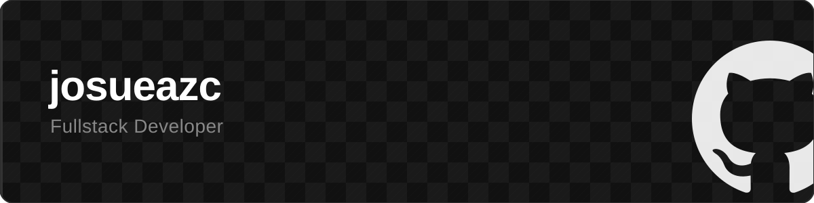

  

 

 

I'm a Full Stack Developer with a passion for building products that make a real difference. Here you can explore the projects I've worked on and my journey through software development.

## About Me

- 🔭 I'm currently building [VELAR](https://github.com/josueazc/VELAR) — blockchain infrastructure for political bond transfers on Stellar.
- 🌱 I'm learning more about **Web3**, **Blockchain**, and **Soroban** smart contracts.
- 💬 Ask me about **React**, **TypeScript**, **Next.js**, and **NestJS**.
- 🥅 Goal: Build solutions that generate real impact for others.
- ⚡ Fun fact: I love design and building things from scratch.

 

 

# Tech Stack

## Backend

  
  
  
  
  
  
  

## Frontend

  
  
  
  
  
  
  
  
  

## Databases

  
  
  
  
  

## Tools

  
  
  
  
  
  

 

# GitHub Stats

